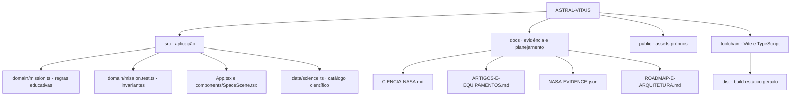
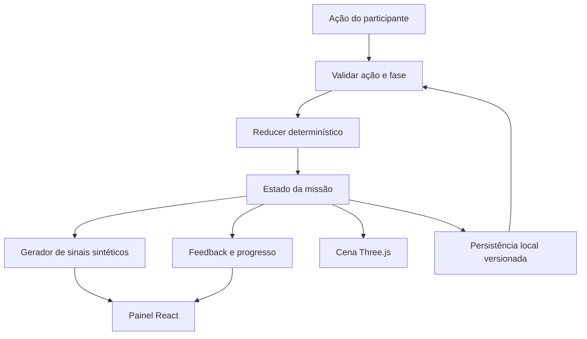
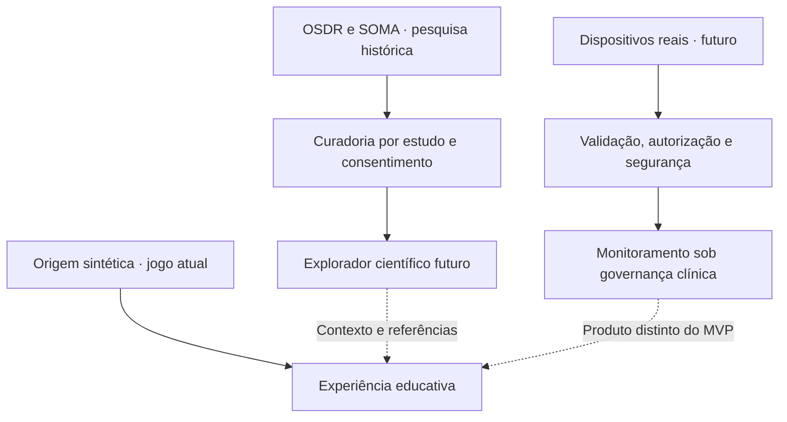

# ASTRAL VITAIS — arquitetura, roteiro de evolução e apresentação

Data: **14/11/2026, Brasília**. Equipe **ASTRAL VITAL**. Produto **ASTRAL VITAIS**.

## 1. Tese do projeto

**ASTRAL VITAIS transforma sinais em decisões de cuidado espacial.** O participante acompanha um astronauta fictício, percorre preparação, órbita e retorno, reconhece um problema e escolhe uma precaução. A experiência explica por que a ação faz sentido e permite revisar decisões.

Escolhemos o tema porque reúne uma necessidade humana clara, problemas científicos relevantes e uma experiência demonstrável. NASA organiza os perigos de voo humano em radiação, isolamento/confinamento, distância da Terra, gravidade alterada e ambientes fechados/hostis. Esses fatores se combinam e variam conforme a missão. [NASA — Five Hazards](https://www.nasa.gov/hrp/hazards/)

A distância cria a oportunidade de produto mais forte: em uma missão marciana, a NASA descreve atrasos de comunicação que podem chegar a cerca de 21–23 minutos em um sentido e períodos de interrupção. Uma tripulação precisa interpretar contexto e executar ações previstas antes de receber orientação terrestre. [NASA — Mars Communications Disruption and Delay](https://www.nasa.gov/wp-content/uploads/2024/01/mars-communications-disruption-and-delay.pdf)

**Diferencial proposto:** ligar evidência, qualidade de dado e prática. Não basta mostrar pulso, temperatura e oxigenação com aparência convincente. O produto ensina a reconhecer quando a medição não é confiável, quando um risco não aparece naquele sensor e quando comunicar é a ação correta.

Essa justificativa descreve a escolha de design da equipe. Não é alegação de exclusividade de mercado, superioridade clínica ou recomendação da NASA.

## 2. Contrato do MVP educativo

O MVP contém uma experiência navegável de decisão com telemetria sintética e referências científicas. Não exige inserir dados pessoais, usar um sensor físico ou conectar a uma missão real.

### Implementação observada no domínio

Na revisão de `src/domain/mission.ts`, foram encontrados:

| Elemento | Conteúdo implementado no domínio |
|---|---|
| Fases | Pré-voo, órbita e retorno. |
| Roteiro | Nove decisões: linha de base, sono, exercício, nutrição/hidratação, radiação, visão/SANS, falha de sensor, isolamento/equipe e readaptação. |
| Escolhas | Três alternativas por cenário, com explicação e justificativa. |
| Progresso | Respostas registradas e nota educativa separada da saúde do avatar. |
| Sinais | Frequência cardíaca, saturação periférica, temperatura, CO₂, taxa de dose e sono fictícios. |
| Qualidade | Dado válido, antigo e inválido; leitura inválida é ocultada. |
| Reprodutibilidade | Estado, seed e relógio simulado produzem as mesmas leituras. |
| Restauração | Validação de estado e reconstrução das respostas; o arquivo salvo não define a própria pontuação. |
| Finalização | Percurso pode terminar com qualquer qualidade de resposta, preservando a aprendizagem após erro. |

`mission.test.ts` contém verificações de progressão, restauração, respostas inválidas, determinismo e sinal degradado. A existência desses testes não prova que uma execução passou. A evidência final de comandos executados e publicação deve constar no README/registro de entrega.

Na revisão posterior de `src/App.tsx`, a interface implementa as quatro áreas de navegação, nove decisões com feedback, controles de cena, painel de sinais, fontes, linha do tempo de equipamentos, exportação JSON e tentativa de persistência local com aviso de falha. Essas observações descrevem leitura do código; não substituem teste de navegador. O catálogo `src/data/science.ts` mantém separados riscos, referências, equipamentos e requisitos.

### Critérios de aceite da interface

- Interface React e cena Three.js com modo de movimento reduzido.
- Todos os controles principais acessíveis por teclado e toque.
- Texto, decisões e explicações permanecem legíveis sem depender do canvas.
- Na fase terrestre, altitude e contexto não continuam sendo apresentados como órbita.
- O rótulo de simulação é persistente e os eventos informam sua origem fictícia.
- Taxa de dose usa unidade de taxa; dose acumulada só aparece quando realmente calculada.
- O registro anterior de sono não é representado como medida nova a cada segundo.
- CO₂ instantâneo fictício não recebe um selo de conformidade com uma média normativa de uma hora.
- Conclusão mostra decisões e explicações, não uma aprovação médica.
- Reinício e restauração funcionam, inclusive após uma escolha inadequada.
- O aviso de evento solar permanece ativo diante de uma resposta inadequada; responder não equivale a executar a proteção prevista.

## 3. Mapa estrutural

### Organização do repositório

Mapa da estrutura lógica, sem pressupor que toda proposta futura já exista:

### Fluxo de dados do MVP

As regras educativas e o estado de missão não devem depender do frame rate da cena. O canvas apresenta contexto, mas não é a autoridade sobre pontuação, respostas, limites científicos ou restauração. Isso permite reduzir qualidade gráfica sem modificar a lógica do jogo.

### Fronteiras

| Camada | Responsabilidade | Evitar |
|---|---|---|
| Domínio | Missões, transições, validação e feedback. | Estado científico dentro de animações. |
| Telemetria sintética | Valores fictícios determinísticos, qualidade e contexto. | Confundir ruído visual com modelo fisiológico validado. |
| Interface | Expor ações, origem, unidade e explicação. | Cor como único canal de informação. |
| Cena | Espaço, astronauta, foco e navegação visual. | Bloquear o uso quando WebGL falhar. |
| Persistência | Manter progresso educativo no navegador. | Chamar armazenamento local de prontuário seguro. |
| Conteúdo | Fontes, versões e distinção entre pesquisa e padrão. | Afirmar que a NASA certificou o projeto. |

## 4. Offline e persistência: promessas precisas

O domínio é executável localmente e não precisa consultar servidor para gerar os sinais ou decidir o resultado de uma escolha. A interface pode persistir o estado no navegador. Isso permite continuar uma sessão enquanto os recursos necessários já estiverem carregados.

**Persistência local não é uma aplicação completamente disponível offline.** Sem um service worker e uma estratégia de cache verificada, um navegador pode não conseguir abrir o endereço novamente sem rede. Também não há, neste escopo, sincronização entre dispositivos, contas, autenticação, backup remoto ou histórico médico no servidor.

Para evolução, implementar cache versionado do shell e assets, fallback offline, migração de estado, teste de atualização e recuperação após cache incompleto. A interface deve mostrar se uma exportação representa uma sessão concluída ou parcial. Downloads de registros devem continuar marcados como sintéticos.

## 5. Evolução de dados: três origens separadas

O OSDR reúne diferentes tipos de dados de pesquisa, incluindo ômicas, fisiologia, comportamento, imagens e telemetria ambiental. Isso não o transforma em stream de sinais vitais de astronautas em atividade. [NASA — About OSDR](https://science.nasa.gov/biological-physical/data/osdr/)

As regras de acesso variam por estudo. A NASA diferencia dados públicos de arquivos restritos e orienta solicitar acesso controlado quando necessário. Não é adequado espelhar indiscriminadamente sequências humanas ou inferir que um artigo aberto autoriza todo uso dos dados. [NASA — Controlled Access](https://www.nasa.gov/reference/osdr-tutorials-requesting-controlled-access-datasets/)

No módulo científico futuro, cada conjunto deve expor espécie, missão, duração, tecido, método, unidade, instante de coleta, processamento e versão. Dados de roedores não devem aparecer como dados humanos. Uma coleta laboratorial processada em horas ou dias não deve aparecer como leitura contínua do traje.

Para sensores reais, exigir contrato de observação com `observedAt`, `receivedAt`, unidade, identificação do dispositivo, qualidade e motivo de ausência. Processar dados atrasados e fora de ordem; não confiar que o relógio do dispositivo esteja sincronizado. Uma perda de conexão não significa ausência de alteração fisiológica.

Esses campos e fronteiras são decisões arquiteturais propostas pela equipe, não uma especificação oficial NASA.

## 6. Roteiro de evolução

As durações são estimativas de planejamento. Não são compromissos de entrega automatizada nem autorização de uso clínico.

| Marco | Prioridades | Critério de saída |
|---|---|---|
| **Beta demonstrável** | Integrar nove decisões, cena imersiva, qualidade de sinal, progresso, reinício, restauração e fontes. | Percurso inteiro executado em desktop e celular; build e testes essenciais verdes; links da entrega conferidos. |
| **Beta revisada** | Revisão de um especialista em medicina aeroespacial/fisiologia, revisão de linguagem, checagem independente de referências e contraste. | Problemas científicos críticos corrigidos; distinção entre pesquisa, regra e ficção compreendida por usuários. |
| **Release 1 educativa** | Ações com sequência, retorno visível de intervenção, debrief completo, acessibilidade e offline real. | Abertura offline testada; fluxo completo por teclado; exportação válida; desempenho aceitável em equipamento alvo. |
| **Release 1.1 científica** | Explorador de estudos públicos selecionados, linha do tempo dos aparelhos, cartões de evidência e comparação longitudinal. | Proveniência e condições de acesso para cada conjunto; dados humanos e animais separados; nenhuma inferência clínica sem validação. |
| **Piloto educacional** | Sessões com público alvo e avaliação de aprendizagem antes/depois. | Evidência de compreensão, taxa de erro e retenção; não apenas tempo de permanência. |
| **Pesquisa com dispositivos** | Integração limitada e autorizada de sensores, pipeline seguro e revisão institucional. | Protocolo, consentimento, validação metrológica e clínica adequados ao uso pretendido. Não decorre automaticamente de terminar o jogo. |

### Prioridade P0 — antes de apresentar o beta

1. Não afirmar dados ao vivo da NASA, eficácia clínica ou homologação.
2. Completar a missão sem travamento, inclusive escolhendo respostas parciais/inadequadas.
3. Mostrar sem ambiguidade o estado do sinal.
4. Remover números de órbita quando a narrativa estiver em solo.
5. Garantir que fontes abram e o domínio não dependa da rede.
6. Explicar que a pontuação mede escolhas e não saúde, aptidão ou resiliência de uma pessoa.

### Prioridade P1 — fortalecer a experiência de aprendizagem

- Trocar parte das alternativas por ações em ordem: conferir identidade, contato e horário; só então aceitar a leitura.
- Acrescentar um cenário de CO₂ ambiental para demonstrar que sinais fisiológicos não substituem suporte de vida.
- Implementar integral de dose sintética não decrescente e distinguir exposição histórica de taxa instantânea.
- Integrar abrigo como posição na cena e deixar claro qual mudança é uma regra didática.
- Permitir revisão de escolhas anteriores sem adulterar a tentativa original.
- Adicionar modo guiado e modo livre, ambos sem pressão para ignorar sintoma.
- Exibir fontes específicas por afirmação, em vez de apenas uma lista geral no rodapé.

### Prioridade P2 — ampliar a missão

- Perfil lunar com poeira e procedimentos EVA simulados.
- Perfil marciano com atraso e fila de comunicação, sem resposta fictícia instantânea.
- Cenário de laboratório com amostras e metadados, diferenciando coleta, processamento e interpretação.
- Linha do tempo interativa de equipamentos com status: histórico operacional, uso atual, demonstração ou pesquisa.
- Conteúdo bilíngue e métricas de aprendizagem agregadas, voluntárias e minimizadas.

## 7. Riscos técnicos e decisões

| Risco | Efeito | Resposta proposta |
|---|---|---|
| GPU limitada ou contexto WebGL perdido | Cena desaparece ou trava. | Fallback visual e controles HTML funcionais; limitar resolução e efeitos. |
| Frame rate baixo | Cronômetro ou lógica aceleram/desaceleram. | Domínio independente do loop de renderização. |
| `localStorage` indisponível | Progresso não persiste. | Avisar de forma discreta, manter jogo em memória e oferecer exportação. |
| Estado antigo/corrompido | Missão inconsistente. | Versão, validação e migração; reinício seguro. |
| Duplo clique | Pontuação duplicada ou salto de cenário. | Ação idempotente e transição controlada. |
| Link científico deixa de funcionar | Afirmação perde verificabilidade. | Registrar título, DOI/requisito, data e URL canônica. |
| Fonte científica muda | Conteúdo antigo continua parecendo atual. | Revisão editorial explícita e versões da regra. |
| Valor falso parece clínico | Participante confunde demonstração com recomendação. | Rótulo permanente, proveniência e feedback contextual. |
| Usuário se sente mal com movimento | Experiência fica inacessível. | Movimento reduzido, pausa e navegação sem rotação automática. |
| Mistura de dados públicos e restritos | Exposição indevida em evolução de pesquisa. | Curadoria por estudo e acesso controlado fora do jogo público. |

## 8. Verificação que precisa acompanhar cada entrega

### Software

- Fluxo completo com escolhas recomendadas e não recomendadas.
- Restauração antes da resposta, durante feedback e após conclusão.
- Falha de sensor não apresentada como normalidade.
- Reinício, exportação e acessibilidade do diálogo/debrief.
- Desktop, celular, movimento reduzido e falha de WebGL.
- Bundle sem chaves, credenciais ou dados reais de saúde.

### Ciência

- Fonte primária, data de consulta e revisão do padrão.
- Unidade, janela temporal e escopo do valor.
- Separação de estudo de solo, animal, missão curta e missão longa.
- Nenhuma promessa de cura para SANS ou proteção radiológica absoluta.
- Nenhuma dose de medicamento ou prescrição baseada em telemetria sintética.
- Nenhum selo de conformidade sem matriz e evidência correspondentes.

### Aprendizagem

- Participante entende por que deve conferir qualidade do sinal?
- Entende que pulso normal não exclui alteração visual ou risco ambiental?
- Distingue monitorar de proteger?
- Consegue explicar por que acompanhamento continua após o pouso?
- Reconhece que a nota é de decisões no cenário, não de sua saúde?

## 9. Pitch sugerido

> Quanto mais longe da Terra, menos espaço existe para interpretar um sinal errado. O ASTRAL VITAIS coloca o participante dentro de uma missão para aprender a observar, confirmar e agir. Em uma experiência imersiva, ele prepara a linha de base, protege descanso e exercício, responde a um evento solar e percebe quando o problema é o sensor. Cada decisão mostra a razão e a fonte científica. Nosso beta usa dados sintéticos e começa pela educação; a evolução é um explorador de evidências e um ambiente de treinamento com validação especializada.

### Demonstração de três minutos

| Tempo sugerido | Ação | Mensagem |
|---|---|---|
| 0:00–0:30 | Apresentar cena e painel. | Saúde espacial combina corpo, ambiente e rotina. |
| 0:30–1:05 | Validar leitura de referência. | Antes de interpretar, conferir origem e qualidade. |
| 1:05–1:45 | Mostrar evento de sensor ou solar. | Medir e proteger são ações diferentes. |
| 1:45–2:20 | Mostrar visão/SANS ou retorno. | Um wearable não mede tudo; acompanhamento continua. |
| 2:20–3:00 | Debrief, fonte e roadmap. | Há transparência científica e um caminho verificável de evolução. |

Não prometer que o protótipo prevê doenças, substitui equipe médica ou usa telemetria real. A apresentação ganha credibilidade quando a equipe mostra exatamente o que implementou, como testou e onde termina a evidência.

## 10. Relação com os demais documentos

- `CIENCIA-NASA.md`: riscos, contramedidas e requisitos oficiais selecionados.
- `ARTIGOS-E-EQUIPAMENTOS.md`: leitura dos dois PDFs anexados, evolução dos equipamentos e limitações de extrapolação.
- `NASA-EVIDENCE.json`: fontes e regras com metadados para futura integração editorial.
- `src/domain/mission.ts`: comportamento educativo implementado.
- `src/domain/mission.test.ts`: verificações do domínio.

Esta revisão de arquitetura é de produto e engenharia. Não atesta conformidade integral com NASA-STD-3001, segurança de voo ou adequação clínica.
